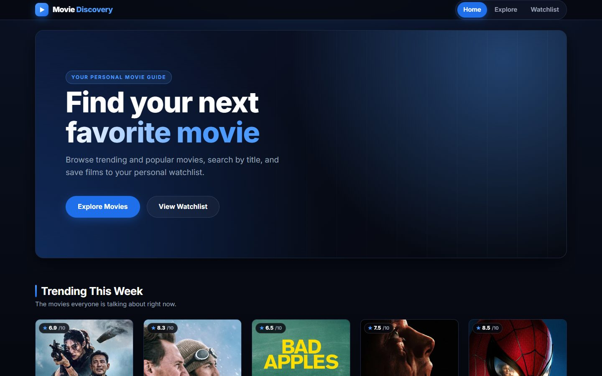
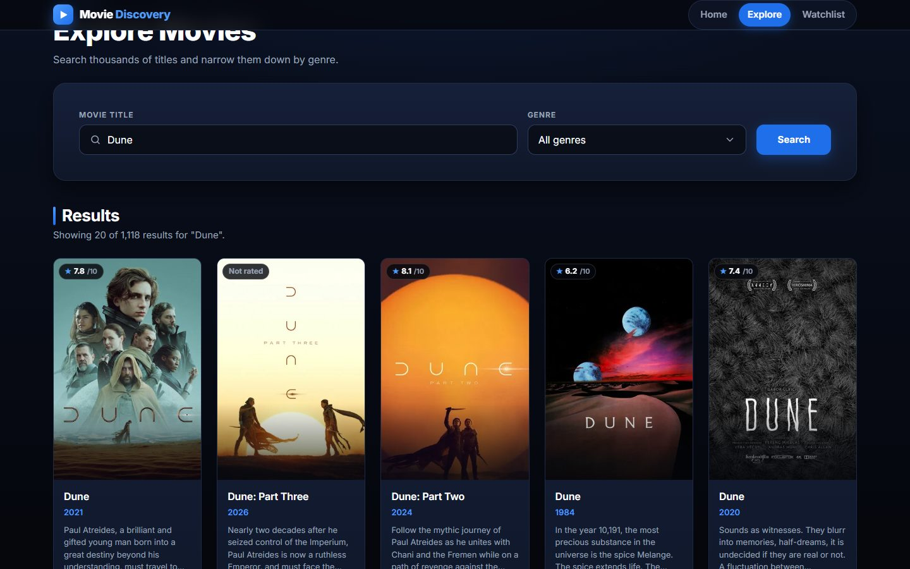
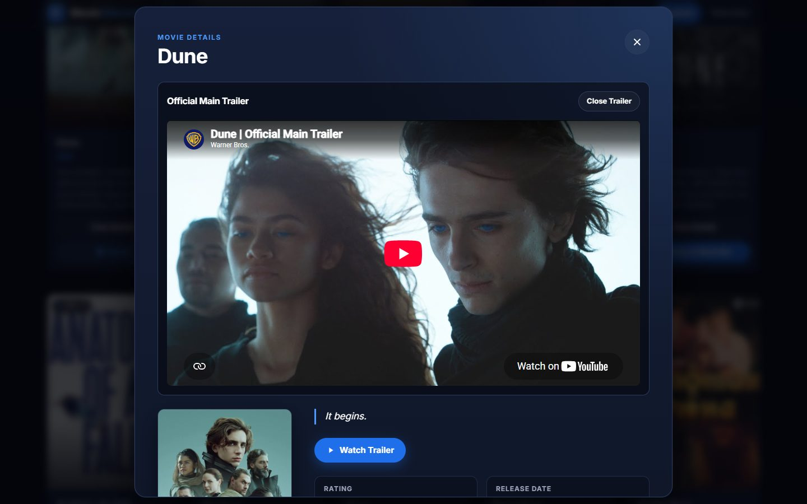
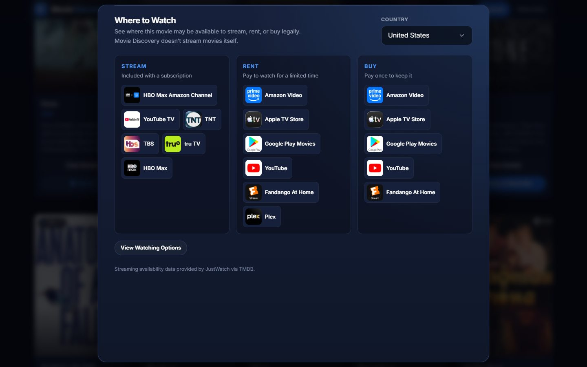
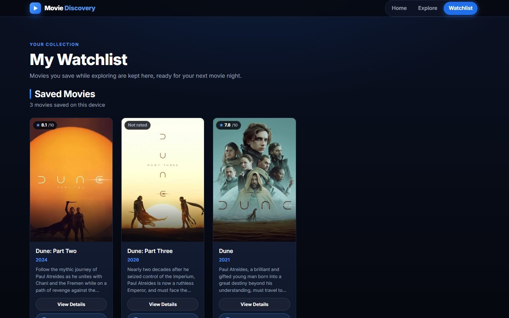
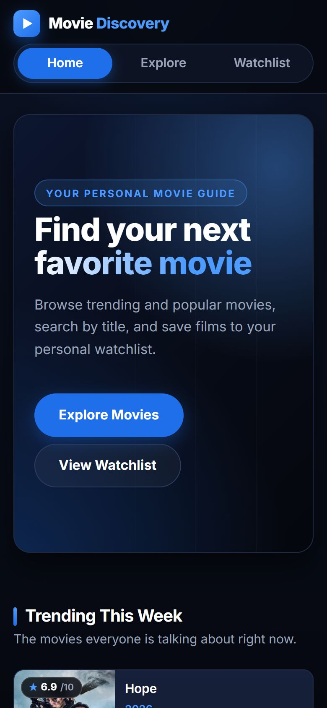

# Movie Discovery & Watchlist

An educational capstone project: a responsive, accessible, multi-page web app for discovering movies, watching trailers, checking where a movie can be watched legally, and keeping a personal watchlist. Data comes from [The Movie Database (TMDB) API](https://developer.themoviedb.org/).

> **This is a movie discovery tool, not a streaming service.** It does not host, stream, or download full movies. Trailers are official YouTube embeds, and the "Where to Watch" section only shows which services may offer a movie (data from JustWatch via TMDB), with a link to TMDB's watch page.



## Educational Purpose

This project was built step by step to practise:

- Semantic HTML5, modern CSS3 (custom properties, Flexbox, Grid, media queries, animations), and vanilla JavaScript with no frameworks.
- Working with a real REST API **safely**, with the secret token kept on a server and never in the browser.
- Handling real-world conditions: loading states, errors, retries, offline visitors, empty results, and bad data.
- Building for everyone: keyboard support, screen readers, reduced motion, and screens from 375px phones to 1440px desktops.

## Features

| Page | What it does |
| --- | --- |
| **Home** (`index.html`) | Animated hero, **Trending This Week** and **Popular Movies** (20 each). If one section fails, the other still loads, and each has its own **Try Again** button. |
| **Explore** (`explore.html`) | Search by title, **genre filter** (filters loaded results without a new request), results count (e.g. *Showing 20 of 177 results for "batman"*), and clear messages for empty, invalid, or failed searches. |
| **Watchlist** (`watchlist.html`) | Saved movies (newest first), **Remove from Watchlist**, a count, and an empty state. Works without any API request. |
| **Movie details** (all pages) | Pop-up window with poster, tagline, rating and votes, release date, runtime, language, genres, and full overview. Opens instantly the second time (cached). |
| **Trailers** | Picks the best official YouTube trailer and plays it in a privacy-enhanced (`youtube-nocookie.com`) embed **only after the visitor clicks**. No autoplay. Closing the trailer or the window removes the player at once, so sound stops immediately. |
| **Where to Watch** | **Stream** (subscription), **Rent**, and **Buy** options for the United States, Canada, United Kingdom, France, or Australia. Changing country reuses the data already downloaded. |
| **Watchlist buttons** | Save / Saved toggle on every card, with confirmation messages. Stays in sync across tabs. |
| **Movie cards** | Poster (lazy-loaded) or a labelled "No poster available" box, rating badge, year, and short overview. |
| **Accessibility** | Skip link, landmarks, logical headings, labelled controls, `aria-live` announcements, visible focus rings, a focus-trapped window that returns focus when closed, full keyboard use, and `prefers-reduced-motion` support. |
| **Motion** | Staggered hero entrance, card entrance waves, scroll reveals (`IntersectionObserver`), and modal open/close transitions. All are switched off for visitors who prefer reduced motion. |

### Screenshots

| Explore: search results | Movie details with trailer (not autoplaying) |
| --- | --- |
|  |  |

| Where to Watch (Stream / Rent / Buy) | Watchlist |
| --- | --- |
|  |  |

<p align="center"></p>

## Technologies Used

| Area | Technology |
| --- | --- |
| Structure | HTML5 (semantic elements, `<dialog>`, ARIA where needed) |
| Styling | CSS3 (custom properties, Flexbox, Grid, `@keyframes`, media queries) with the Inter font from Google Fonts |
| Behavior | Vanilla JavaScript (ES2022, no frameworks or libraries) |
| Data | TMDB API v3, with JustWatch data via TMDB for watch providers |
| Video | YouTube embeds (`youtube-nocookie.com`) |
| Storage | Browser `localStorage` (watchlist) |
| Security | Vercel serverless function (`api/tmdb.js`) that keeps the token on the server |
| Hosting | Vercel (static files + serverless function, free Hobby plan) |
| API testing | Postman and the browser DevTools Network tab |

There is **no build step and no `package.json`**: the files are served exactly as they are.

## TMDB API Endpoints

The browser only ever calls **`/api/tmdb?path=…`** on this site. The proxy forwards approved paths to `https://api.themoviedb.org/3`:

| Endpoint | Used for | Allowed parameters |
| --- | --- | --- |
| `/trending/movie/week` | Home: Trending This Week | `page`, `language` |
| `/movie/popular` | Home: Popular Movies | `page`, `language`, `region` |
| `/search/movie` | Explore: search (`query` required, max 100 characters) | `query`, `page`, `include_adult` (defaults to `false`), `language`, `region`, `year`, `primary_release_year` |
| `/genre/movie/list` | Explore: genre dropdown | `language` |
| `/movie/{id}` | Movie details | `language` |
| `/movie/{id}/videos` | Trailers | `language` |
| `/movie/{id}/watch/providers` | Where to Watch (all countries in one reply) | none |

Poster and logo images load directly from TMDB's public image server (`image.tmdb.org`), which needs no token.

## Project Folder Structure

```
movie-discovery-capstone/
├── index.html            # Home: hero, Trending, Popular
├── explore.html          # Search, genre filter, results
├── watchlist.html        # Saved movies (localStorage)
├── styles.css            # All styles: design tokens, layout, components, animations, responsive rules
├── script.js             # All browser JavaScript (shared by the three pages; uses <body data-page="…">)
├── api/
│   └── tmdb.js           # Vercel serverless proxy: validates requests and adds the secret token
├── docs/
│   └── screenshots/      # Images used in this README
├── .env.example          # Template showing the variable name (no real value)
├── .gitignore            # Keeps .env, .env.local, and .vercel/ out of Git
└── README.md
```

## Security: Why a Serverless Proxy?

Anything in frontend JavaScript can be read by any visitor with the browser's developer tools. If the TMDB **API Read Access Token** were in `script.js`, anyone could copy and misuse it.

```
Browser (script.js)  →  /api/tmdb (Vercel function)  →  api.themoviedb.org/3
                         • reads TMDB_READ_ACCESS_TOKEN
                           from server environment variables
                         • adds it as an Authorization header
                         • returns only TMDB's JSON
```

The proxy also protects itself and TMDB:

- **GET only.** Other methods get `405`.
- **Fixed destination.** The TMDB host and `/3` version are hard-coded, so the proxy can't be pointed at any other website.
- **Allow-list.** `path` must exactly match an approved endpoint or a strict pattern such as `/movie/{positive number}`. Anything else, including full URLs, `../` tricks, or other TMDB endpoints, gets `400`.
- **Parameter checks.** Every query parameter must be allowed for that endpoint, appear only once, and pass its validation (for example `page` must be 1–500). Unknown parameters such as `api_key` are rejected.
- **Timeouts.** TMDB gets 8 seconds (`504 TMDB_TIMEOUT` after that). The browser gives up after 15 seconds and shows a friendly message with **Try Again**.
- **Safe errors.** Every error is JSON `{ "error": { "code", "message" } }` with no token, stack trace, or TMDB internals. Details go to server logs only.
- **Caching.** Successful replies may be cached by Vercel's CDN for 5 minutes (`s-maxage=300`), which reduces calls to TMDB.

The token is **never** committed: `.env` and `.env.local` are in `.gitignore`, and `.env.example` shows only the variable name.

## Local Installation and Development

You need [Node.js](https://nodejs.org/) 18 or newer, a free [Vercel](https://vercel.com/) account, and a free [TMDB](https://www.themoviedb.org/) account.

1. **Clone the repository**
   ```bash
   git clone <your-repo-url>
   cd movie-discovery-capstone
   ```
2. **Install the Vercel CLI and log in**
   ```bash
   npm install -g vercel
   vercel login
   ```
3. **Set up the environment variable** (see the next section).
4. **Start the local server**
   ```bash
   vercel dev
   ```
   On the first run, accept the prompts to link or create a Vercel project. If asked for a framework, choose **Other**, and leave the build command and output directory empty.
5. Open **http://localhost:3000** (or the port `vercel dev` prints).

Opening the HTML files directly (`file://`) or using a plain static server (e.g. Live Server) shows the layout, but the proxy won't run, so movies can't load. The app then shows *"The movie service is not available right now"*. Use `vercel dev`.

> **Windows tip:** during long `vercel dev` sessions, the CLI may leave one background `node` process per function call running. If requests get slow or the server reports *out of memory*, stop `vercel dev` (Ctrl + C) and start it again. This only affects local development, not the deployed site.

## Environment Variable Setup

| Variable | Where it's used | Value |
| --- | --- | --- |
| `TMDB_READ_ACCESS_TOKEN` | `api/tmdb.js` (server only) | Your TMDB **API Read Access Token** (the long token, not the short "API Key") |

1. Get the token: themoviedb.org → **Settings → API** → copy the **API Read Access Token**.
2. Copy the template:
   ```bash
   cp .env.example .env.local      # Windows PowerShell: Copy-Item .env.example .env.local
   ```
3. Open `.env.local` **in your editor** and paste the token after `TMDB_READ_ACCESS_TOKEN=`. Never paste it into source code, chats, issues, or commit messages.
4. Restart `vercel dev` after changing it.
5. Check that Git ignores it: `git status` must **not** list `.env.local`.

## Testing

### Quick API checks (with `vercel dev` running)

Open these URLs in the browser (replace the port if needed):

| URL | Expected |
| --- | --- |
| `/api/tmdb?path=/search/movie&query=Avatar` | `200`, movie JSON |
| `/api/tmdb?path=/trending/movie/week` | `200`, 20 movies |
| `/api/tmdb?path=/movie/19995/watch/providers` | `200`, `results` with country codes |
| `/api/tmdb?path=/search/movie` | `400`, missing `query` |
| `/api/tmdb?path=/account` | `400`, endpoint not allowed |
| `/api/tmdb?path=https://example.com` | `400`, endpoint not allowed |
| `/api/tmdb?path=/search/movie&query=a&api_key=x` | `400`, unknown parameter |
| `/api/tmdb?path=/movie/9999999999` | `404`, `NOT_FOUND` |

In **DevTools → Network**, click any `tmdb?path=…` request: there must be **no** `Authorization` header and no token in the request or the response.

### Manual test checklist

- **Navigation:** every page's menu highlights the current page; all links open the right page.
- **Home:** Trending and Popular each show 20 cards; posters have alt text; **View Details** opens the window.
- **Explore:** search "batman" (cards plus a results count). Change the genre (count updates, no new request in the Network tab). Search "zzqxjvwkplm" (empty message). Press **Search** with an empty box (message, red border, focus stays in the box).
- **Details and trailer:** open a movie, click **Watch Trailer**, press play, then **Close Trailer** or Escape. The sound stops at once and focus returns to **Watch Trailer**. Press Escape again to close the window; focus returns to the card's **View Details** button.
- **Where to Watch:** change the country; the Stream / Rent / Buy lists update.
- **Watchlist:** save a movie, open the Watchlist page, **refresh**, and it's still there. Remove it to see the empty state.
- **Errors:** in DevTools → Network, choose **Offline** and search. You should see a friendly message, **Try Again**, and your text kept. Go back **Online**, then click **Try Again**.
- **Keyboard only:** Tab, Shift+Tab, Enter, Space, and Escape operate everything; while the details window is open, Tab never leaves it.
- **Reduced motion:** DevTools → ⋮ → More tools → **Rendering** → *Emulate CSS prefers-reduced-motion: reduce*. Content appears instantly and the window closes without fading.
- **Responsive:** DevTools device toolbar at **375, 440, 768, 1024, 1440 px**. Nothing overlaps and there's no sideways scrolling.
- **Console:** no red errors during normal use.

## Watchlist Storage (localStorage)

- The watchlist is saved in **this browser's `localStorage`** under the key `movieDiscoveryWatchlist`.
- It is stored **separately for every visitor, browser, and device**. There are no accounts and no server copy, so a list saved in Chrome on a laptop won't appear in Safari or on a phone.
- Clearing site data, or browsing in a private window, removes or isolates it.
- If storage is blocked or full, the app explains why instead of failing silently. If saved data is damaged, a backup copy is kept under `movieDiscoveryWatchlist-backup`.

## Deployment (Vercel)

The project is compatible with Vercel as-is: static HTML/CSS/JS are served from the project root, and every file in `api/` becomes a serverless function (`api/tmdb.js` → `/api/tmdb`). All file paths are relative (`styles.css`, `script.js`, `explore.html`) and the frontend calls the relative route `/api/tmdb`, so they work on any domain. No `vercel.json` is needed.

1. **Check Git first.** Run `git status` and confirm `.env.local` is **not** listed (it's in `.gitignore`).
2. **Push to GitHub.** Push the project to your GitHub repository.
3. **Import into Vercel.** Go to [vercel.com/new](https://vercel.com/new), choose **Import Git Repository**, and select the repository.
4. **Configure the project:**
   - Framework Preset: **Other**
   - Root Directory: the folder that contains `index.html` (usually `./`)
   - Build Command: *leave empty* · Output Directory: *leave empty* · Install Command: *leave empty*
5. **Add the environment variable before deploying:** expand **Environment Variables**, add **Key** `TMDB_READ_ACCESS_TOKEN` and **Value** your token, and make sure **Production** is selected (also tick **Preview** if you want preview deployments to load movies).
6. Click **Deploy**.
7. **If you add or change the variable later** (Project → **Settings → Environment Variables**), go to **Deployments**, open the latest one, and choose **Redeploy**. Existing deployments don't pick up changed variables.

From then on, every push to the main branch deploys to Production automatically.

### Testing the deployed site

On `https://<your-project>.vercel.app`:

1. **Home:** Trending and Popular load. In DevTools → Network, the `tmdb?path=…` requests return `200` and show no `Authorization` header or token.
2. **Explore:** search, filter by genre, open details, play a trailer and close it, and change the Where to Watch country.
3. **Watchlist:** save two movies, open the Watchlist page, and refresh: they're still there. Remove one, then refresh again.
4. **Proxy safety:** open `https://<your-project>.vercel.app/api/tmdb?path=/account`. It should return `400` JSON.
5. **Token not configured?** If every section says *"The movie service isn't set up correctly right now"*, the variable is missing for Production. Add it and redeploy. To see server errors, open Vercel → **Logs**.
6. **Phone:** open the site on a real phone and repeat steps 1–3.

## Known Limitations

- **First page only:** searches and lists show TMDB's first page of results (up to 20); there's no pagination. The genre filter applies only to the loaded movies.
- **Watchlist per browser:** saved movies don't sync between browsers or devices (see above).
- **Five countries** are offered for Where to Watch (US, CA, GB, FR, AU).
- **Third-party data:** availability comes from JustWatch via TMDB and can be incomplete or out of date; prices and links aren't shown. Some trailers may be region-locked or have embedding disabled by their owner on YouTube.
- **English UI only;** TMDB text is requested in its default language.
- **Rate limits:** TMDB may limit very heavy use (`429`); the app then asks the visitor to wait and try again.
- **CDN cache:** lists can be up to about 5 minutes old because of Vercel's caching.
- The app needs **JavaScript** for movie data. Without it, the pages, navigation, and layout still display.

## Attribution

- **This product uses the TMDB API but is not endorsed or certified by TMDB.** Movie data, posters, and logos come from [The Movie Database (TMDB)](https://www.themoviedb.org/).
- **Streaming availability data is provided by [JustWatch](https://www.justwatch.com/) via TMDB.** This attribution is also shown in the app next to the data.
- Trailers are embedded from **YouTube**; all trailers, posters, and logos belong to their respective owners.
- Font: [Inter](https://rsms.me/inter/) via Google Fonts.

This project is for educational purposes only and is not a commercial product.
